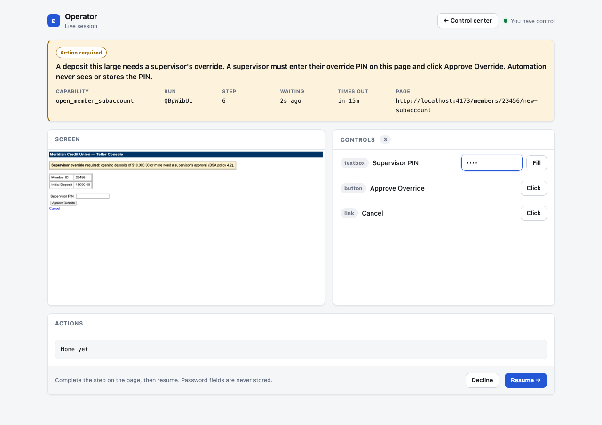
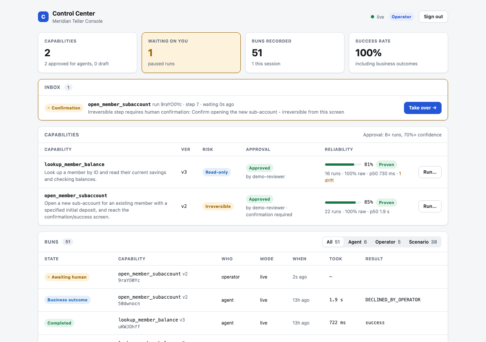

# Computer-Use Automation System

[](https://github.com/SankalpJain3473/computer-use-automation/actions/workflows/ci.yml)

An LLM figures out how to do a task in a legacy back-office web app once, by
driving a real browser. What it did is saved as a typed, versioned
**capability artifact**. From then on, the task replays **deterministically**,
with no model in the loop. AI agents call it by name through a typed API, and
a person can take over the live session whenever a step needs human judgment.

The design write-up is **[REPORT.md](REPORT.md)**; what each evidence folder
proves is in **[evidence/README.md](evidence/README.md)**. A longer illustrated
walkthrough of requirements, design, results and every case is in
**[docs/overview.pdf](docs/overview.pdf)**.

```
goal ─▶ LLM discovery ─▶ artifact (draft) ─▶ stability runs ─▶ approval ─▶ agents invoke it by name
                              │                    │                               │
                         typed contract     confidence score        pauses for a human on irreversible steps
```

| Operator takeover: a supervisor-only step on the live session | Control center: capabilities, reliability, inbox, runs |
|---|---|
|  |  |

## Setup

Requires Node 20+ and Chromium for Playwright.

```bash
npm install
npx playwright install chromium
cp .env.example .env    # paste an OpenRouter key (free tier is fine)
```

Only `discover` and `agent-demo` call an LLM. Everything else (the target app,
replay, stability, approval, the server, the scenario catalog, and the tests)
runs with no key and no network.

**Sign-in and keys.** There is no registration: back-office staff accounts come
from a bank's identity provider, never self sign-up. The first `npm run server`
issues two keys into `.keys.json` (gitignored, owner-only):

- the **operator** key signs a person in to the control center at `/login`;
- the **agent** key is what an AI agent sends as `Authorization: Bearer <key>`.

An agent key can only list and call *approved* capabilities. It can't run
drafts, start "supervised" runs, see the operator inbox, or open a takeover
console, so an agent can never confirm its own irreversible action. Set
`AGENT_API_KEY` / `OPERATOR_API_KEY` to use your own keys instead. (The stand-in
bank app has its own teller login, `teller1` / `demo`. The system signs in to it
before every run and never records those credentials.)

## Demo path

**1. Start the stand-in bank app** (a deliberately legacy teller console: table
layouts, no test IDs) on http://localhost:4173. Log in as `teller1` / `demo` if
you want to click around.

```bash
npm run target-app
```

**2. Discovery: an LLM records a capability.** This drives a real browser
through the app and saves a *draft* artifact to `artifacts/`.

```bash
npm run discover -- --capability=lookup_member_balance --memberId=12345
npm run discover -- --capability=open_member_subaccount --memberId=23456 --initialDeposit=60.00
```

**3. Deterministic replay, no LLM.** The same capability, new inputs.

```bash
npm run replay -- --capability=lookup_member_balance --memberId=23456      # success, typed outputs
npm run replay -- --capability=lookup_member_balance --memberId=99999      # business outcome: MEMBER_NOT_FOUND
npm run replay -- --capability=lookup_member_balance --memberId=40000      # business outcome: PERMISSION_DENIED
npm run replay -- --capability=lookup_member_balance --memberId=50000      # transient timeout, retried, then succeeds
npm run replay -- --capability=open_member_subaccount --memberId=12345 --initialDeposit=75.00
```

The last one pauses at the irreversible "open account" step. Open
http://localhost:4174, then either confirm on the live page and click
**Resume**, or click **Decline** (the caller gets `DECLINED_BY_OPERATOR`).
`node scripts/simulated-operator.mjs` plays that operator if you want it
scripted.

**4. Earn approval.** A draft can't be called by agents. Approval requires
replay evidence: at least 8 runs whose 95% lower-bound success rate is at
least 70% (`config/allowlist.json`). Risky capabilities are measured in
**rehearsal** mode, which stops just before the irreversible step, so proving
reliability never opens real accounts.

```bash
npm run stability -- --capability=lookup_member_balance --runs=10 --memberId=12345
npm run stability -- --capability=open_member_subaccount --runs=10 --memberId=12345 --initialDeposit=50.00
npm run stats
npm run approve -- --capability=lookup_member_balance --reviewer="Your Name"
npm run approve -- --capability=open_member_subaccount --reviewer="Your Name"
```

Approving a risky capability lets agents call it, but its irreversible step
still pauses for a human on every run. Letting it run unattended is a
separate `--allow-unattended-irreversible` grant, and that is refused unless
there are 8 *live*, human-confirmed runs (rehearsals don't count).

To change what a capability checks for (a newly known interstitial, say)
without re-running discovery, `npm run revise -- --capability=<name>` re-applies
the current checks to the originally recorded locators and saves a **new draft
version**. Agents keep getting the approved version until the new one has
earned approval on its own evidence. That's how `lookup_member_balance` went
from v1 to v2.

**5. Agents call capabilities by name.**

```bash
npm run server            # capability API + control center on http://localhost:4180
npm run api-walkthrough   # no LLM: catalog, invoke, idempotent retry, bad input, confirm, decline
npm run agent-demo        # a real LLM is handed the catalog and decides which tools to call
```

Open http://localhost:4180 and sign in with the operator key from
`.keys.json`. The **control center** shows capabilities with their approval
state and reliability, an operator inbox of runs waiting on a human (with
"Take over"), every run's state timeline and step timings, and the exact tool
definitions an agent is shown.

| Endpoint | Who | Purpose |
|---|---|---|
| `GET /api/capabilities?format=openai\|anthropic` | agent, operator | Approved capabilities as tool definitions |
| `POST /api/capabilities/:name/invoke` | agent, operator | `{params, idempotencyKey?}` → `200` finished or `202` awaiting a human |
| `GET /api/runs/:id?wait=terminal` | agent (own runs), operator | Long-poll a run, e.g. while a human confirms |
| `GET /api/interventions` | operator | Runs currently waiting on a person |
| `/runs/:id/operator/` | operator | Takeover console for that run's live session |

```bash
curl -H "Authorization: Bearer $(node -p 'require("./.keys.json").agent')" \
  -H "Content-Type: application/json" \
  -d '{"params":{"memberId":"12345"}}' \
  http://localhost:4180/api/capabilities/lookup_member_balance/invoke
```

## Every case, with an example

```bash
npm run scenarios      # needs only the target app running; no LLM, no key
```

This runs one example of every case the system handles against the live app,
checks each against the exact result it must produce, and writes a report with
per-case evidence (`evidence/scenarios-<time>/README.md`). It exits non-zero if
any case is off.

| Kind | Cases |
|---|---|
| Success | happy path; another tenant re-labelled a button (fallback locator absorbs it, drift recorded); rehearsal of a risky flow |
| Business outcome | member not found; permission denied; validation error |
| Recoverable | transient timeout retried; compliance interstitial dismissed; retries exhausted, then a person fixes it on the live page |
| Human handoff | irreversible step confirmed; declined; handed back without confirming; **a step only a person may do**: a $15,000 deposit needs a supervisor's override PIN, entered by a person on the live page and never recorded, and the supervisor can also refuse |
| Hard failure | retries exhausted and the person gives up; nobody answers a pause before it times out; session expired mid-flow; a tenant re-labelled data no fallback covers; malformed input; control handed back without the required person's step done |
| Guardrail | tampered artifact navigates off the allowlist; a recording that ignores a caller's input is refused |
| Lifecycle | approval refused without evidence |
| Agent API | catalog; invoke by name; idempotent retry; undeclared field rejected; an agent can't confirm its own irreversible action; the agent learns the human's decision |

The stand-in app produces each condition on demand:

- members `40000` (restricted), `50000` (one timeout), `50002` (persistent
  outage), `60000` (session dies), and `80000` (compliance notice);
- deposits of $10,000 or more, which need a supervisor's PIN (`2468` in this
  demo, known only to "the supervisor");
- switchable tenant skins (`POST /debug/skin`).

To try the supervisor case by hand:

```bash
npm run replay -- --capability=open_member_subaccount --memberId=23456 --initialDeposit=15000.00
```

Open http://localhost:4174 and type the PIN into the masked field. Approve
the override, resume, then confirm the account opening.

Every run writes redacted evidence (structured log, `run.json` state record,
screenshots) under `evidence/`, plus one line in `evidence/ledger.jsonl`, which
is what reliability scores are computed from.

## Configuration

| Env var | Default | Purpose |
|---|---|---|
| `OPENROUTER_API_KEY` | none | `discover` and `agent-demo` only |
| `OPENROUTER_MODEL` | `cohere/north-mini-code:free` | any tool-calling model; see `src/llm/model.ts` |
| `TARGET_APP_PORT` / `TARGET_APP_URL` | `4173` | the stand-in bank app; replays navigate to this origin, so one artifact runs against any deployment |
| `TARGET_APP_SKIN` | `standard` | `tenant-b` or `tenant-c` to start the app with another tenant's labels |
| `SUPERVISOR_PIN` | `2468` | the override PIN the stand-in app accepts |
| `OPERATOR_PORT` | `4174` | operator console for CLI runs (tries the next ports if taken) |
| `SERVER_PORT` | `4180` | capability server and control center |
| `INTERVENTION_TIMEOUT_MS` | `900000` | how long a paused run waits for a person before ending as `OPERATOR_TIMEOUT` |
| `MAX_ACTIVE_RUNS` | `4` | concurrent browser runs; beyond this, invoke returns `429` with `Retry-After` |
| `HEADLESS` | `true` | `false` to watch the browser |

Guardrails (allowed origins and action types, approval thresholds) live in
`config/allowlist.json`.

## Tests

```bash
npm test          # 64 tests; no API key needed
npm run typecheck
```

They run the replay engine and the capability server against a real instance
of the target app: business outcomes, transient-failure recovery,
retry-exhausted escalation, rehearsal, human confirm and decline on the same
session, intervention timeout, sign-in and roles, version serving, the
approval gate, idempotency, capacity limits, and input validation. Unit tests cover the run state machine, reliability
scoring, artifact contract checks, and redaction.

CI runs all of the above plus the scenario catalog on every push, then builds
the deploy image, starts it, and invokes a capability through it.

## Run it without installing anything

[](https://codespaces.new/SankalpJain3473/computer-use-automation)

A codespace installs everything, starts the bank app and the control center,
and opens the control center in your browser (a few minutes the first time).
Sign in with the operator key: run `cat .keys.json` in the codespace terminal.
The **Ports** tab also lists the bank app (`teller1` / `demo`). Every command
in the demo path above works in its terminal; discovery needs your own
`OPENROUTER_API_KEY` in `.env`.

## Hosted demo

The `Dockerfile` runs the bank app and the capability server in one container
(Playwright's image, so Chromium is included). Only the server's port is
exposed. On a non-loopback host it refuses to start without
`AGENT_API_KEY` and `OPERATOR_API_KEY`, so keys are never generated where
nobody can read them.

`render.yaml` deploys it to Render's free tier, redeploying on every push:
**New → Blueprint** on render.com, pick this repository, and apply. Render
generates both keys; the operator key is under the service's
**Environment** tab. The free tier has 512 MB of memory and sleeps after 15
idle minutes, so the first request after a pause is slow and runs are limited
to one at a time. Discovery isn't run there; it needs an LLM key and is shown
by the evidence in this repo.

## Layout

| Path | What's in it |
|---|---|
| `src/target-app/` | the stand-in legacy teller console |
| `src/perception/` | turns the live page into ref-addressable elements for the LLM |
| `src/llm/` | the observe → decide → act discovery loop |
| `src/capabilities/` | per-goal definitions: goal wording, contract, outcome checks |
| `src/artifact/` | schema, store, contract validation |
| `src/replay/` | deterministic engine, locator resolution, result contract |
| `src/runs/` | run state machine, executor, ledger, stats, approval |
| `src/escalation/` | session handoff and operator console |
| `src/server/` | capability API, catalog, sign-in and roles, control center |
| `scripts/` | scenario catalog, API walkthrough, agent demo, simulated operator, UI screenshots |
| `src/guardrails/` | allowlist, approval policy, redaction |
